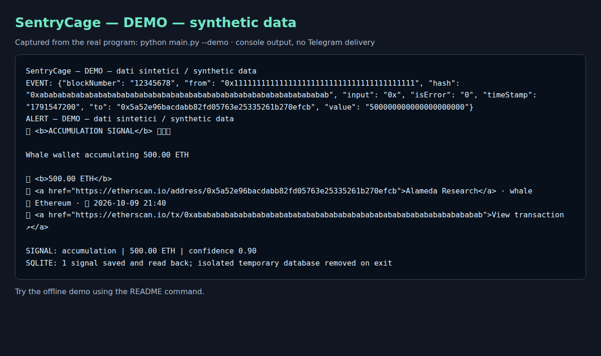

# SentryCage

Self-hosted monitoring of large native-ETH transfers involving a small configured wallet registry.
SentryCage turns raw explorer transactions into rule-based signals, stores them in SQLite and
optionally sends Telegram alerts. Ethereum is enabled by default; Arbitrum requires an explicit
selection and its own RPC endpoint. AI is optional and disabled by default. MIT licensed.

**Try the offline demo.** It needs no keys, Telegram account, RPC endpoint or `.env`.

The functioning demo prints this summary (synthetic data, excerpt of actual program output):

```text
SentryCage — DEMO — dati sintetici / synthetic data
SIGNAL: accumulation | 500.00 ETH | confidence 0.90
SQLITE: 1 signal saved and read back; isolated temporary database removed on exit
```

It also prints the raw event and the real HTML alert formatter's output.
The event uses a registered wallet address, but the hash, amount and transfer are synthetic.
Demo explorer links refer to synthetic data; they are not evidence of a real transaction.

## Run the demo

From a local checkout of this candidate, use Python **3.12**:

```bash
python3.12 -m venv .venv
.venv/bin/python -m pip install -r requirements.txt
.venv/bin/python main.py --demo
```

If your distribution lacks `ensurepip`, install its Python 3.12 venv package, or use `uv`:

```bash
uv venv --python python3.12 .venv
uv pip install --python .venv/bin/python -r requirements.txt
.venv/bin/python main.py --demo
```

The demo uses the production analyzer, signal generator, SQLite storage and alert formatter.
Only acquisition and delivery are replaced with a synthetic fixture and console output.
Its temporary database is deleted on exit; it does not touch the live database.



The screenshot displays captured console output, including literal Telegram HTML markup.
The same real execution is available as [stdout](docs/assets/demo-output.txt) and a
[terminal recording](docs/assets/demo.cast), replayable with `asciinema play`.

## Start live monitoring

Create `.env` yourself from `.env.example` and edit it locally. Never post tokens, keys or your
complete configuration in an issue. Supply `ETHERSCAN_API_KEY`, `ETHEREUM_RPC_URL`,
`TELEGRAM_BOT_TOKEN` and a nonzero integer `TELEGRAM_CHAT_ID`. Negative group IDs are supported.
The RPC must belong to the selected chain. Empty values, placeholders and conflicting AI aliases
stop startup before clients or SQLite are constructed.

Keep `ENABLED_CHAINS=ethereum` and `ENABLE_REASONING=false` for the initial run.
For explicit storage-only monitoring set `NOTIFICATIONS_ENABLED=false`; then Telegram credentials
are unnecessary. To include Arbitrum, select `ENABLED_CHAINS=ethereum,arbitrum` and set `ARBITRUM_RPC_URL`.
Explorer chain availability depends on your service access; it is checked by doctor.

```bash
.venv/bin/python main.py --doctor
.venv/bin/python main.py --once
.venv/bin/python main.py
```

Doctor makes read-only service checks and sends no messages or AI inference requests.
`--once` and normal monitoring send real alerts when notifications are enabled: use a destination
you authorize for these messages. `--test` sends one real synthetic alert; `--preview` sends a
sample gallery, using `TEST_CHAT_ID` or falling back to `TELEGRAM_CHAT_ID`.
No startup Telegram message is sent. An empty scan is a valid outcome; alerts are not guaranteed.

| Exit code | Meaning |
| --- | --- |
| 0 | Demo/doctor/test succeeds; once succeeds without new events |
| 10 | Once succeeds with new events, including those below alert thresholds |
| 2 | Invalid configuration or CLI usage |
| 3 | Service, scan, storage or delivery fails; doctor cannot verify an enabled service |

Docker/Compose v2 is an alternative documented in [DOCKER_SETUP.md](DOCKER_SETUP.md).
The base starts only SentryCage. Ollama and model download require the explicit `ai` profile.
Docker runtime validation is pending on this machine; no container healthcheck claims monitoring health.

## Capabilities and limits

The live loop queries normal explorer transactions and native ETH values, not ERC-20 transfer feeds.
The rule-based generator emits accumulation, distribution, exchange deposit/withdrawal and transfers
between tracked wallets. These labels describe fund flow, not a verified trade or a prediction.
The unusual-activity type is available to the optional AI path; the core does not detect arbitrary anomalies.
Wallet labels and exchange addresses are static examples, not independently verified identity claims.

AI supports Ollama, LMStudio, Claude and OpenAI. When disabled, no LLM provider is constructed or called.
When enabled, the existing reasoning engine may fall back after errors and can contact configured
cloud providers. Provider confidence and market-impact text are interpretations, not calibrated
probabilities or demonstrated predictive accuracy. Doctor checks local model availability without
inference; it reports cloud AI and fallback providers as operationally unverified.

The program is self-hosted, but live monitoring sends requests/credentials to RPC, explorer and Telegram
services. Enabled cloud AI receives transaction/context data. No application account or subscription
is required. Storage grows locally; this pilot does not promise unlimited history or retention automation.

Recovery uses a persistent raw-transaction journal, scan checkpoints and a notification queue.
Signals, immutable messages and local transaction completion commit atomically before delivery.
Interrupted analysis is retried; pending sends survive restart with bounded attempts per cycle and
exponential waiting between retries. Changing Telegram destination leaves old messages pending.
Notifications off pauses existing messages and keeps new signals local. `--once` returns 3 while
notifications on enabled chains remain pending, even if acquisition committed.

Scans read ascending explorer pages over a fixed block range and advance the checkpoint after every
requested wallet finishes locally. Errors, inconsistent pages and an exhausted safety budget retain it.
The first scan starts roughly 100 blocks back; registry changes retain unfinished previous ranges and
also look back for new wallets. Telegram may deliver a duplicate if a send succeeds but its receipt is
lost during a crash or timeout. Chain reorganizations and explorer omissions are not recovered or
independently detected. See [architecture](docs/architecture.md) for recovery and migration limits.

**Demo verified; live unverified.** Local tests validate the offline path and mocked delivery.
Python 3.12.3 on Linux/WSL is verified; other Python versions, operating systems, Termux,
Docker runtime and real RPC/explorer/Telegram/AI integration are not certified by this run.

## Customize wallets

SQLite is the shared runtime wallet registry. Static examples seed it **once** on initialization;
existing labels and thresholds are preserved. Configure the same database path used by `DB_PATH`:

```python
from src.config.wallet_registry import WalletInfo, WalletCategory, Chain
from src.config.runtime_wallets import WalletRegistry
from src.database.sqlite import init_db

db_path = "./data/whale_tracker.db"  # Use your actual DB_PATH.
init_db(db_path)
registry = WalletRegistry(db_path)
registry.put(WalletInfo(
    address="0x1111111111111111111111111111111111111111",
    category=WalletCategory.WHALE,
    name="My monitored wallet",
    chains=[Chain.ETHEREUM],
    threshold_override=100.0,
))
# To stop monitoring on this chain:
# registry.remove("0x1111111111111111111111111111111111111111", Chain.ETHEREUM)
```

This address is an example; replace it with an address you intend to monitor.
The tracker reloads wallet settings at the next cycle. Removed or inactive wallets stay removed
across restart; editing static examples changes the seed for a fresh database. Each chain can have
its own category, label and threshold for the same address. `threshold_override=None` follows the global
`TRANSACTION_THRESHOLD`. Settings changes apply to future/uncompleted work; committed signals and
queued messages remain unchanged. A wallet threshold controls significance; the generator retains minimum amounts
(50 ETH for accumulation and 100 ETH for distribution).

## Documentation and development

[Configuration and migration](docs/configuration.md) · [Architecture](docs/architecture.md) ·
[Troubleshooting](docs/troubleshooting.md) · [Manual testing checklist (Italian)](docs/manual-testing.md) ·
[Contributing](CONTRIBUTING.md) · [Changelog](CHANGELOG.md)

```bash
.venv/bin/python -m pytest tests/ -q
.venv/bin/python -m pytest tests/ --cov=src --cov-report=term-missing --cov-fail-under=40
```

The suite covers configuration/startup, SQLite rollback and process-exit recovery, delivery leases,
retry ambiguity, paginated acquisition, shared wallet settings, AI provenance and network-free demo.
RPC/explorer/Telegram/AI services are simulated in these tests. Failures can originate in code,
dependencies or the environment; reproduce and classify them before drawing a conclusion.
Report bugs and questions through [GitHub Issues](https://github.com/SentryCage/sentrycage/issues).

SentryCage monitors and analyzes; it executes no trades. Signals and AI interpretations are not
financial advice and do not establish future price movements. See [LICENSE](LICENSE).
