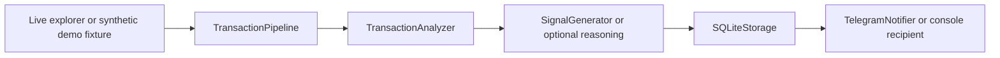

# Architecture

`main.py` parses mutually exclusive modes before dotenv, clients or SQLite initialization.
The demo dispatch happens first. Live settings are validated by `Settings.from_env`.
`WhaleTracker` acquires normal transactions for static wallets on enabled chains only.

`TransactionPipeline` keeps the analyzer/generator real while allowing external clients,
storage and recipients to be injected. `SQLiteStorage` initializes a file database, deduplicates
per hash/chain, serializes signals, and reads them back. Constraint errors propagate.
Telegram outcomes are `sent`, `no_recipient`, `disabled`, `error`; only `sent` is truthy.
Disabled notifications are accepted by the pipeline as explicit local-only operation.
Missing recipients and failed deliveries fail the scan after persistence.
Connection status becomes connected only after `get_me`; doctor also checks `get_chat`.

The live coordinator advances a chain cursor only after all requested wallets succeed.
Explorer timeout, HTTP/API errors and malformed replies raise distinct errors. A full page
(100 transactions) fails conservatively instead of silently skipping potential later pages.
Continuous mode logs failure types without exposing provider URLs and retries on the next interval.
Once mode exits on failure. A prior successful chain may have advanced when a later chain fails.

## Known recovery and audit work

- Marking occurs before analysis/storage/delivery. After an error or crash, an already marked
  transaction may be skipped on the next scan. Moving the mark after sending would introduce
  duplicates and does not replace a transactional checkpoint/outbox design.
- Cursors exist only in memory; initial lookback is about 100 blocks. No crash recovery guarantee.
- Explorer pagination is not implemented; full pages block advancement until follow-up work.
- Telegram has no persistent queue, retry schedule or defined duplicate-delivery semantics.
- The live tracker/analyzer use the static registry; SQLite wallet records are a separate utility.
- Signal metadata now preserves the serialized signal, but AI attribution, fallback provenance,
  historical schema fields and storage fidelity still need a separate audit.
- AI analysis can fail or fall back to the existing reasoning engine's rules; no guaranteed prediction,
  monitoring coverage, delivery, timing or anomaly detection is certified.

Doctor has no storage initialization or inference. It validates the selected RPC chain ID and block,
explorer read query, Telegram token/chat access and selected local model listing. This is a
point-in-time availability check; cloud AI and fallback providers remain unverified.
