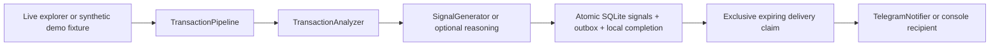

# Architecture

`main.py` parses mutually exclusive modes before dotenv, clients or SQLite initialization.
The demo dispatch happens first. Live settings are validated by `Settings.from_env`.
`WhaleTracker` acquires normal transactions for active SQLite wallets on enabled chains only.
Tracker and analyzer share one per-cycle registry snapshot. Static examples seed it once;
per-chain labels, categories, tags and thresholds persist across restart.

`TransactionPipeline` keeps the analyzer/generator real while allowing external clients,
storage and recipients to be injected. `SQLiteStorage` initializes a file database, deduplicates
per hash/chain, serializes signals, and reads them back. Constraint errors propagate.
Raw transactions enter `transaction_work` before analysis. An exception leaves them pending;
restart recovers pending work for enabled chains with current analysis/registry settings.
One SQLite commit stores every signal, its immutable message/payload in `notification_outbox`,
the processed marker and journal completion. Network sends happen after that transaction.
Concurrent processing can repeat analysis, but one local completion commits for a hash/chain.
Completed journal entries preserve deduplication beyond legacy cleanup.

Telegram outcomes are `sent`, `no_recipient`, `disabled`, `error`; only `sent` is truthy.
Notifications off records new messages as disabled and pauses existing queued messages.
Missing recipients and failed deliveries keep their intent pending and fail delivery status.
Connection status becomes connected only after `get_me`; doctor also checks `get_chat`.

The coordinator persists a chain checkpoint after all pages of all active wallets complete locally.
Delivery can remain pending after that checkpoint advances. Checkpoints use a registry fingerprint;
a new fingerprint starts from the earlier of the previous checkpoint and current head minus 100,
while an existing fingerprint resumes its own checkpoint. Scope/head selection persists atomically
so a registry change during downtime retains the unfinished previous range.

Explorer pages use ascending order and fixed start/end blocks. Hash duplicates are removed;
conflicting copies, invalid bounds/order, repeated full pages, API failures or an exhausted page
budget fail the scan without advancing that checkpoint. A full page requires another request.
Continuous mode logs error types and retries; once returns 3 on errors or pending delivery.
A prior successful chain may have committed while a later chain fails.

Delivery claims are exclusive SQLite leases, at least 60 seconds or REQUEST_TIMEOUT + 30.
Each flush claims at most 100 messages; cycles flush before and after acquisition. Sends are bounded
by REQUEST_TIMEOUT, failures wait 5 seconds then double up to one hour, and attempts persist.
Expired claims can be recovered; an old owner cannot acknowledge a newer owner's receipt.
Queues bind to the original recipient key and chain. Changing Telegram subscribers leaves old
messages pending and reports failure; disabled chains retain messages without sending them.

Signals preserve schema-versioned provenance in metadata: rules, AI or rule fallback, requested
and selected provider, reported/configured model, provider substitution and fallback cause.
AI prompts/output require the full transaction hash and chain; absent/unknown references or invalid
output invoke the rule generator used by AI-off mode. Refinements merge by type, hash and chain.
Wallet metadata and amounts come from analyzed input. Timestamp, reasoning, impact, actions,
correlations, context and provenance survive SQLite/outbox serialization. Rule fallback is stored
as whale_tracker and explicitly labeled in the alert.

## Migration and remaining limits

- Back up an existing database before upgrading. Updates add journal/checkpoint/outbox tables and
  wallet metadata columns. Existing signals, wallet values and legacy processed markers remain.
  Legacy markers cannot prove old delivery or recover raw data never saved; historical signals
  are not rewritten and no synthetic delivery receipts are created.
- A successful send followed by a lost receipt, crash, expired lease or ambiguous timeout can
  result in duplicate delivery. Exactly-once Telegram delivery is not promised. Pending messages
  retry until delivered or operator configuration pauses/remedies them.
- New databases start about 100 blocks back. Block hashes/finality/reorganization replay are not
  implemented; an RPC height below the checkpoint fails explicitly. Explorer indexing completeness
  and stable data within a fixed range cannot be certified by pagination alone.
- Journal, signals and outbox grow without automatic retention. Legacy cleanup does not delete
  journal-backed completion markers. Tests cover process exits, not hardware power-loss failures.
- Provenance records the producing path/provider/model, not the truth of AI text. Model information
  is marked response-reported or configuration-derived. Legacy records remain unaudited; context/tool
  facts and interpretation accuracy require independent validation.
- AI analysis can fail or fall back to the existing reasoning engine's rules; no guaranteed prediction,
  monitoring coverage, delivery, timing or anomaly detection is certified.

Doctor has no storage initialization or inference. It validates the selected RPC chain ID and block,
explorer read query, Telegram token/chat access and selected local model listing. This is a
point-in-time availability check; cloud AI and fallback providers remain unverified.
